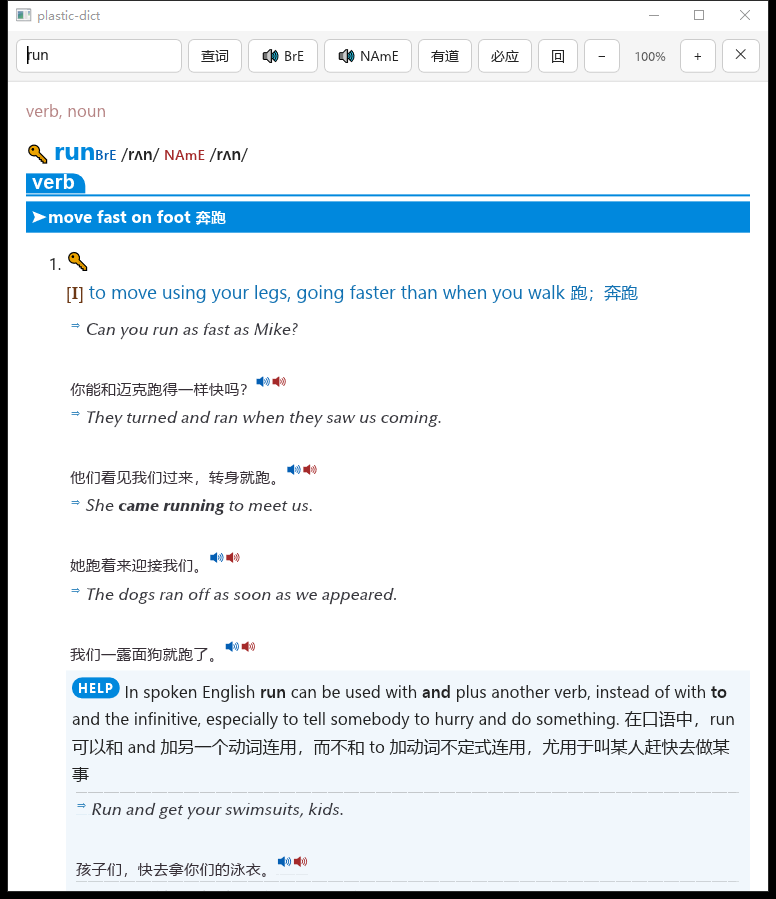

# plastic-dict

A no-frills GoldenDict alternative — **Rust + Dioxus Native (Blitz)**.

Local MDX/MDD dictionaries (Oxford 9) + Bing online translation + online dictionary lookup:
no runtime, no GTK/WebKit system dependencies, and no JS engine — the GUI's HTML/CSS
is rendered natively by Blitz (Stylo + Taffy + Vello/WGPU).

**Portable mode**: all data lives in the binary's own directory (the only exception is
the throwaway pronunciation cache, which goes to `/tmp` on Unix).

[中文文档](README.zh-CN.md)

## Screenshots

| Local dictionary: apple | Local dictionary: run | Online dictionary (Youdao) |
|---|---|---|
|  |  |  |

## Features

- **Local dictionaries**: MDX v1.2 / v2.0 + MDD resource archives
  - zlib-compressed blocks; LZO / encryption (Salsa20, fast-XOR index encryption)
    are reported with clear errors
  - On-disk index cache `cache/index` (custom compact format; invalidated and rebuilt
    automatically when a dictionary's size/mtime changes)
  - Multi-volume MDD (`stem.mdd` / `stem.1.mdd` / …), images inlined as `data:` URIs
  - Webfonts embedded in the dictionary CSS or shipped inside MDD (e.g. Oxford's Optima)
    are registered automatically at startup
  - Pronunciation button: winmm MCI on Windows (in-process); elsewhere it tries
    `mpv` → `paplay` → `aplay` → `ffplay` → `cvlc`, then falls back to the system default
- **Online translation**: Bing Edge API (automatic fallback when a word isn't in the dictionary)
- **Online dictionaries**: Youdao / Bing — fetched server-side → sanitized → typeset for the
  reader, with a one-click "open in browser" (Blitz has no JS engine or iframe support,
  see the comparison table below)
  - Sanitizing strips nav/header/footer/login/search boxes/table-of-contents bars/ad
    slots, empty shells (including empty table cells) and fixed-height inline styles;
    remote images are dropped too (the renderer only has a `data:` channel, so keeping
    them would just leave blank boxes sized by `width/height`)
- **GUI**: lookup box, phonetic transcription with pronunciation button, Ctrl zoom,
  site shortcuts, stacked pages
- **CLI plain-text mode** (`-t`): handy for scripts and hotkey word grabbers

## Build

```bash
# Windows (MSVC toolchain required; the GNU toolchain lacks gcc/dlltool)
cargo +stable-x86_64-pc-windows-msvc build --release

# Linux / macOS
cargo build --release
```

The artifact is `target/release/plastic-dict` (`.exe` on Windows): a single file with no
system GUI/browser dependencies. Rust version requirement is in `Cargo.toml`
(`rust-version`).

Prebuilt Linux x86-64 / arm64 portable tarballs are published on
[Releases](../../releases) by CI (`.github/workflows/release.yml`), triggered by `v*` tags.

## Portable layout

```
plastic-dict(.exe)      # the binary
dicts/Oxford9           # dictionary (.mdx/.mdd; a same-named .css is appended automatically;
                        #   multi-volume stem.N.mdd supported)
config/config.json      # config (zoom/width/height/maximized/scroll_step)
config/extra.css        # optional: user CSS patch, appended after the dictionary CSS
cache/index/            # index cache (.pdc; invalidated when size/mtime changes)
/tmp/plastic-dict/audio # pronunciation files (Unix; Windows uses cache/audio)
logs/                   # crash.log / play.log / DIC_DUMP output
```

Drop the contents of `dicts/Oxford9` from the
[goldendict](https://github.com/yanyingwang/goldendict) Baidu Netdisk share into
`dicts/Oxford9`. The `GOLDENDICT_DIR` environment variable can point the dictionary
elsewhere without touching the in-package layout.

CSS precedence is **dictionary CSS → built-in fixes (`OXFORD9_CSS` in
`src/gui/style.rs`) → `config/extra.css`**, the latter winning at equal specificity.
If an element lays out badly under Blitz, don't edit the `.mdx/.mdd` — add a rule to
`config/extra.css`.

Dictionary files are memory-mapped read-only: Oxford 9's three MDD volumes (~700 MB)
never get copied into the heap, so resident memory follows on-demand page loading instead
of a 819 MB upfront allocation.

## Usage

```bash
plastic-dict "apple"             # word → GUI local dictionary
plastic-dict "long time no see"  # phrase/Chinese → GUI online dictionaries
plastic-dict -t "apple"          # CLI plain text (Bing translation if not found)
plastic-dict -t "hello world"    # CLI: phrases still open the GUI online dictionary window
plastic-dict --purge-cache       # clear the index cache
plastic-dict -h                  # help
```

Example Linux hotkey command (translate the current selection):

```bash
bash -lc '$HOME/.local/app/plastic-dict/plastic-dict "$(/usr/bin/wl-paste -n -p)"'
```

GUI shortcuts:

| Key | Action |
|---|---|
| `Enter` | Look up |
| `Esc` | Close window |
| `Ctrl` `=` / `+` | Zoom in |
| `Ctrl` `-` | Zoom out |
| `Ctrl` `0` | Reset to 100% |

Zoom (0.5–3.0) is saved to the config automatically; the toolbar also has `-` / percentage /
`+` buttons.

## `config/config.json`

```json
{
  "zoom": 1.0,
  "width": 760,
  "height": 860,
  "maximized": false,
  "scroll_step": 135
}
```

- `zoom`: saved automatically by shortcuts/toolbar buttons
- `width` / `height`: window size (manual; window geometry is no longer remembered)
- `maximized`: when `true`, start maximized (width/height then apply only when unmaximized)
- `scroll_step`: wheel step in pixels per notch, default `135`, clamped to `20–240`.
  Applies to devices that report line-based wheel deltas (`winit` wrapper);
  precision touchpads sending pixel deltas scroll by their own granularity.

## Environment variables

| Variable | Description |
|---|---|
| `GOLDENDICT_DIR` | Dictionary directory (default `<exe>/dicts`; `~` supported) |
| `DIC_DUMP` | Set to `1` to dump the latest entry (sanitized) HTML/CSS to `logs/last.html` / `logs/last.css`; online pages go to `logs/last_web_0.html` (Youdao) / `logs/last_web_1.html` (Bing), plus `[web]` pruning counters |

## Blitz rendering adaptations

Blitz 0.2 lays out pages but is not a complete engine. Below are the differences observed
on this engine and how this program handles them (`src/gui/style.rs`, `src/gui/fonts.rs`):

| Issue | Symptom | Handling |
|---|---|---|
| Table layout out-of-bounds panic | dictionary CSS `display:table*` triggers a `blitz-dom` panic | `localize_css` downgrades: `table-cell`→`inline-block`, everything else→`block` |
| `@font-face` ignored in inline `<style>` | embedded Optima/oalecd9 don't load; text falls back to serif | scan dictionary CSS at startup and register fonts by CSS family name + weight/style (`gui/fonts.rs`) |
| No per-glyph fallback (emoji only) | `⇒`, `➤` and similar render as tofu | explicitly target `Segoe UI Symbol` family for those marker elements |
| `padding`/`margin` on inline boxes ignored | `/rʌn//rʌn/`, `[I]to move`, `verb,noun` run together | insert real spaces during sanitizing (`prepare::sanitize_html`); CSS spacing won't work |
| Leading/trailing whitespace in inline boxes is trimmed | spaces placed at the end of an inline box vanish as "line-end" | spaces must sit *between* boxes (`</gram-g> <def>`), never inside one |
| Backgrounds on plain inline boxes are not painted | section headers `shcut-blk` (white text + blue background on a child) become invisible | lift the background to the block element (`shcut-blk { background: #08d }`) |
| UA stylesheet colors/underlines `a:link` | every word in an entry is an `<a>`; text looks like a web page link soup | `a, a:link, a:visited { color: inherit; text-decoration: none }`, underline on hover only |
| No `float` support | images/word-family boxes don't float; laid out as blocks | accepted (nothing lost, just positioned differently from GoldenDict) |
| No scrollbar | long entries give no scroll position feedback | wheel/touchpad scrolling works (`blitz-shell` handles MouseWheel), but nothing to drag |
| No `zoom` support | zooming breaks | rewrite px/pt font sizes in CSS by the zoom factor |

## Differences from the Bun + WebView version

The original Bun/TypeScript version is kept in `bak/` (older Python/TS single file) and
`legacy/` (Bun version) for reference only.

| Item | Old (Bun + webview-bun) | This version (Rust + Blitz) |
|---|---|---|
| Runtime | Bun + node_modules (6 deps incl. js-mdict) | single Rust binary |
| GUI | GTK4 WebKitGTK WebView + local HTTP server + JS injection | Dioxus Native + Blitz native rendering, no WebView, no JS |
| Dictionary parsing | js-mdict (npm package, delisted) | own parser (port of js-mdict 7.0.0 logic, with format fixes) |
| Index cache | JSON (sha1 path key) | custom compact binary `PDIDX02` (fnv1a path key) |
| Resource references | HTTP server on `127.0.0.1` random port, `/res/...` | inlined `data:` URIs (blitz-shell data-uri provider) |
| Online dictionaries | stacked iframes (rendered in WebView) | server-side fetch → sanitize (nav/ads/empty shells/remote images) → reader typesetting; external links open in the system browser |
| HTML processing | htmlparser2 + dom-serializer | html5ever + markup5ever_rcdom (own serialization and style extraction) |
| Zoom | WebKit native `zoom_level` | CSS `font-size` scaling (Blitz has no zoom property) |
| Esc to close | JS listener (fails while focus is inside a cross-origin iframe) | keyboard events reach the root div directly (`autofocus`), no iframe problem |
| DevTools | right-click → inspect | no Inspector; use `DIC_DUMP=1` dumps |
| Package size | tens of MB + node_modules | ~30 MB single release binary |

## Project structure

```
src/
  main.rs         entry / CLI dispatch / panic hook
  mdict/          MDX/MDD parsing (parse.rs) + dictionary pool/lookup (mod.rs) + index cache (cache.rs)
  gui/            Dioxus Native app (app.rs) + Blitz startup & net provider (mod.rs/net.rs)
                  + styles & dictionary CSS fixes (style.rs) + embedded font registration (fonts.rs)
  textrender.rs   entry HTML → CLI plain text
  prepare.rs      entry HTML/CSS sanitizing and resource inlining (data URI)
  dom.rs          html5ever wrapper (parse/serialize/attributes)
  online.rs       online dictionary page fetching
  translate.rs    Bing translation
  config.rs / paths.rs / util.rs
examples/
  boxdump.rs      headless layout probe: lays out a dumped HTML/CSS once and prints every node's box
tools/
  make_fixture.py  generate MDX/MDD test fixtures (testdata/)
  grab_window.py   capture the GUI window (pure ctypes GDI, arbitrary window size)
  crop_png.py      screenshot crop/zoom (pure zlib, for pixel-level rendering checks)
  send_click.py    send a single click to the window (verify buttons/pronunciation)
  send_wheel.py    send a wheel event to the window (Blitz has no scrollbar; this is how scrolling is verified)
testdata/        fixture dictionary (3 entries + 2 resources, 2 key blocks + 2 record blocks)
shots/          GUI acceptance screenshots (real Oxford 9: run / apple / Chinese online page)
bak/ legacy/     old sources (Python / Bun+TS), for reference only
```

## Tests

```bash
cargo test                              # 38 unit tests
python tools/make_fixture.py            # regenerate testdata/ fixtures
```

Fixtures cover MDX v2.0 multi-block parsing, cross-record-block lookup, case-insensitive
lookup, MDD resource resolution, data URI rewriting for all three `url()` quote forms,
`@font-face` parsing (inline base64 / path / weight-style) and online page noise
stripping, among other end-to-end paths.

For rendering issues, a headless probe beats guessing from screenshots:

```bash
DIC_DUMP=1 ./plastic-dict "apple"
cargo run --release --example boxdump -- \
    logs/last.html logs/last.css 760 860 --min-x=600
```

It reproduces the GUI structure `div.root > .toolbar + .content > [style, entry]` and
prints `x/y/w/h` plus a text snippet for every node, showing exactly which element
overflows the line width.

## Troubleshooting

- **First CLI run is slow**: the index cache is built on first use, then reused; it is
  invalidated and rebuilt when dictionary files change. `--purge-cache` clears it manually.
- **Startup slower than lookup**: startup scans dictionary CSS to register embedded webfonts,
  which loads the MDD index once (measured ~0.1s for Oxford 9 with a warm cache). Dictionaries
  without `@font-face` skip this.
- **LZO / encryption unsupported**: the dictionary uses compression or encryption that isn't
  implemented yet; convert it with another tool first (e.g. repack with zlib).
- **No pronunciation audio**: Windows uses system MCI and needs no extra components; on Linux
  install one of `mpv`/`ffplay`/`vlc`. Log: `logs/play.log`.
- **Crash**: log at `logs/crash.log`.
- **Broken rendering**: run `DIC_DUMP=1 plastic-dict "word"`, inspect `logs/last.html` /
  `logs/last.css`, then print layout boxes with `examples/boxdump.rs`. For pure style issues,
  prefer overriding in `config/extra.css`. Note that Blitz ignores `padding`/`margin` on
  inline boxes — spacing has to be inserted as spaces in the HTML.
- **Online page still shows full navigation**: `DIC_DUMP=1` also writes `logs/last_web_0.html`
  (Youdao) / `last_web_1.html` (Bing); look at the leftover elements' class/id and add the
  keywords to `prepare::WEB_NOISE_EXACT` / `prune_web_noise`.
